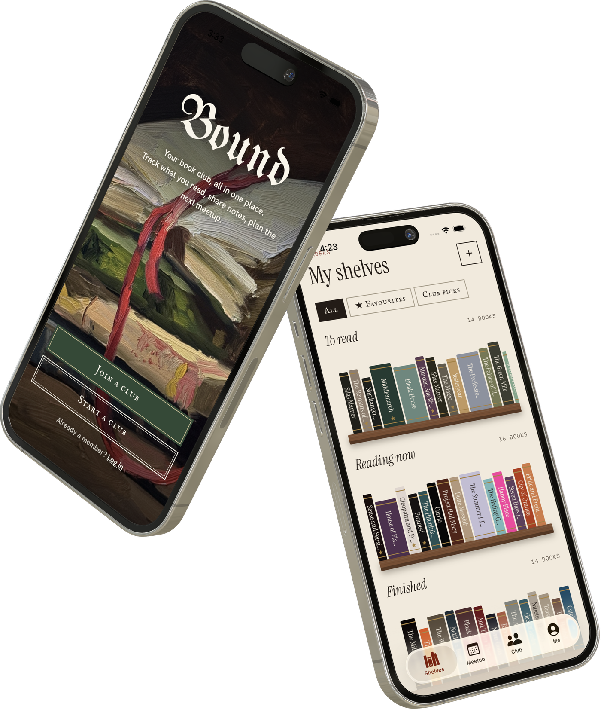
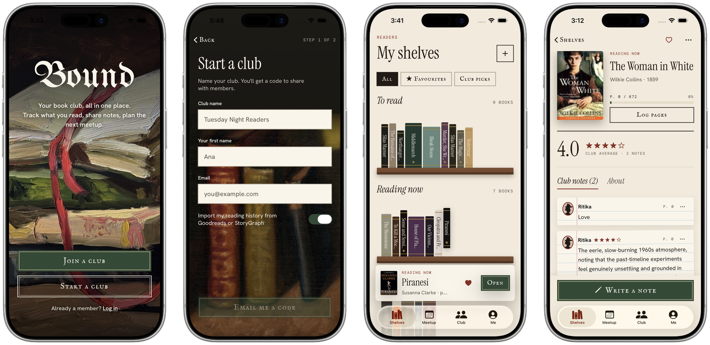
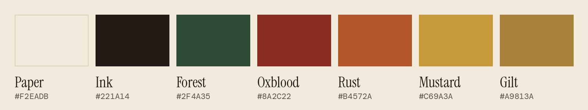
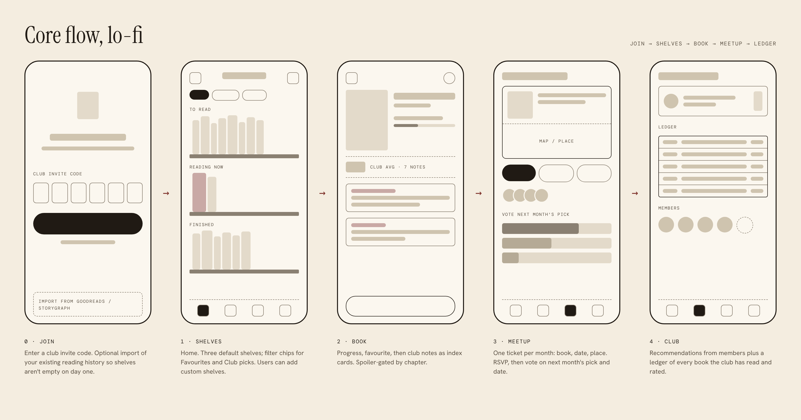

<p align="center">
  
</p>

<h1 align="center">Bound</h1>

<p align="center">
  <em>Your book club, all in one place.</em><br>
  Track what you read, share notes, plan the next meetup.
</p>

<p align="center">
  
  
  
  
</p>

<p align="center">
  
</p>

---

Book clubs live in five places at once. The pick is in a group chat, progress is on Goodreads, notes are in a notes app, and the meetup address is buried somewhere in the thread. Nobody wants spoilers, and nobody knows what page anyone else is on.

**Bound puts it in one place, and makes it feel like paper and ink.**

<p align="center">
  
</p>

## Features

**Shelves that feel like shelves**
To read, Reading now and Finished, standing on oak planks. Tap a spine to lift it off the shelf, tap anywhere else to put it back. Real covers come from Open Library, and each spine takes its colour from the cover's edge.

**Add any book**
Search by title, author or ISBN, or scan the barcode on the back cover.

**Notes that don't spoil**
Every note saves the page its author was on. Notes past your page fold away until you choose to read them. Ruled index cards, star ratings, a "discuss at meetup" tag, and you can edit or delete your own.

**The monthly meetup**
A tear-off ticket with the book, date and place. RSVP Going, Maybe or Can't, and Going lands an ink stamp. The host puts books up for a vote, everyone votes, the host plans the meetup from the winner.

**Live with your club**
Notes, RSVPs and votes show up on everyone's phone in about a second.

**The club ledger**
Every past meetup, like a library due-date card, with the club's average rating and yours.

**Portraits, not initials**
Pick one of six Victorian cut-paper silhouettes and a colour.

**The tear**
Leaving the start screen and joining a club rip the page away to reveal the app underneath.

## Design



| Role | Typeface |
| --- | --- |
| Masthead | UnifrakturMaguntia |
| Headings, shelf names | Instrument Serif |
| Buttons (letterpress small caps) | IM Fell English SC |
| Body | Hanken Grotesk |
| Labels | DM Mono |

Square letterpress buttons, custom paper menus instead of system ones, and a wax seal for the app icon.

<details>
<summary><b>Early lo-fi wireframes</b></summary>
<br>

</details>

## How it works

- **Offline first.** Your shelves live in SwiftData on the phone and sync to Postgres about a second after each change. The app pulls the server copy when it opens.
- **Live club data.** Members, meetups, RSVPs, votes and notes come from Supabase, and Realtime pushes changes as they happen.
- **Permissions in the database.** Row-level security decides who sees what: clubmates can read your shelf, only hosts plan meetups, and recommendations are visible only to sender and recipient.
- **Passwordless.** Join with a 6-character invite code; sign in with an 8-digit code sent to your email.
- **Real books.** Open Library for search, ISBN lookup and covers. VisionKit reads the barcode and only accepts 978/979 codes, the ones printed on books.

## Stack

| | |
| --- | --- |
| App | Swift, SwiftUI, SwiftData, iOS 26 |
| Backend | Supabase: Postgres + row-level security, Auth, Realtime |
| Books | Open Library |
| Scanning | VisionKit |
| Email | Resend (custom SMTP) |

## Run it yourself

You need Xcode 26 and a free Supabase project.

1. **Database.** In the Supabase SQL Editor, run each file in [`supabase/migrations`](supabase/migrations) in order.
2. **Sign-in.** Under Authentication → Sign In / Providers → Email, keep Email OTP on. The app expects **8-digit** codes (change `JoinClubView.signInCodeLength` if yours differ). Set up custom SMTP and add `{{ .Token }}` to the "Magic link or OTP" and "Confirm sign up" email templates.
3. **Keys.** Copy `Bound/Bound/Backend/Secrets.swift.example` to `Secrets.swift` and add your project URL and **anon public** key. It's git-ignored. Never put the `service_role` key in the app.
4. **Run.** Open `Bound/Bound.xcodeproj` and run. Barcode scanning needs a real iPhone.

<details>
<summary><b>Project layout</b></summary>

```
Bound/Bound/
  App/          root tabs and the tear transition
  Backend/      Supabase client, sign-in, sync, Open Library, covers
  Components/   buttons, avatars, silhouettes, paper menu
  Features/     Onboarding, Shelves, Book, AddBook, Meetup, Club, Me
  Models/       SwiftData models
  Theme/        colours and fonts
  Resources/    font files
supabase/
  migrations/   SQL to set up the database
docs/images/    README images
```
</details>

## Roadmap

- [ ] Recommendations between members
- [ ] Sign in with Apple
- [ ] TestFlight beta
- [ ] Meetup reminders and add to calendar
- [ ] Goodreads import

## Credits

Book data and covers from [Open Library](https://openlibrary.org). Fonts from Google Fonts under the SIL Open Font License.

<p align="center"><sub>Designed and built by <a href="https://rjoshi141.github.io/portfolio-v2/">Ritika Joshi</a></sub></p>
